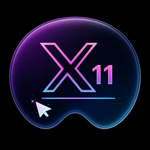
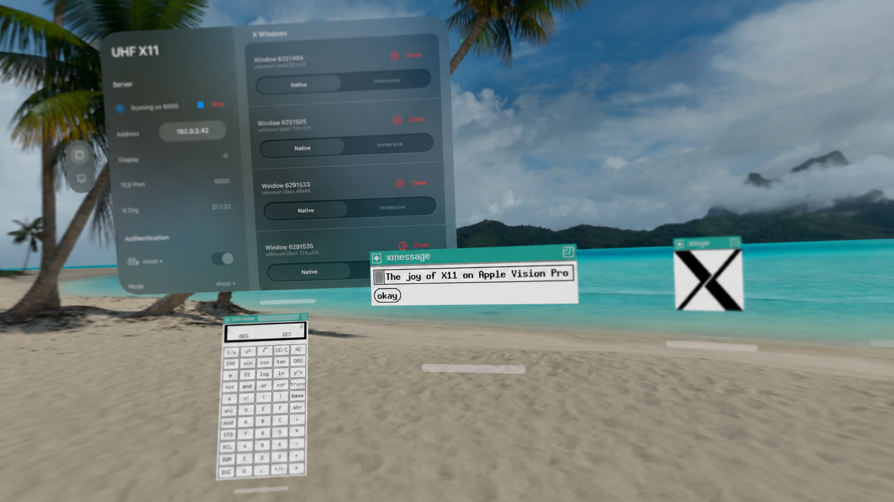

<p align="center">
  
</p>

# UHF X11

UHF X11 is a native X11 display server for Apple Vision Pro. It runs an embedded X.Org server and presents remote X11 applications as independent spatial windows on visionOS.



Copyright © 2026 I. Finder &lt;[src@lispm.net](mailto:src@lispm.net)&gt;. This source snapshot is released under the [MIT License](LICENSE). Project information is available at [lispm.net/apps/uhf-x11](https://www.lispm.net/apps/uhf-x11/).

## Highlights

- Rootless X11 windows presented as native visionOS windows.
- Standard TCP display `:0` with MIT-MAGIC-COOKIE-1 authentication by default.
- Pointer, keyboard, focus, close, scroll, damage, and resize integration.
- Bundled X.Org bitmap fonts plus importable user font packs.
- Exact-pixel presentation and optional CRT-inspired display effects.
- Experimental indirect GLX/OpenGL 1.1 fixed-function rendering through Metal.
- Pinned, reproducible X.Org component versions and bundled license notices.

## Project Status

The core 2D server is published as a 1.0 snapshot. App Store builds include the custom GLX provider, but it is disabled by default and is advertised to X11 clients only after the user enables **Experimental GLX** while the server is stopped. GLX is experimental and has limited compatibility and variable device performance. See [Project Status](Docs/STATUS.md) for the implemented boundaries.

UHF X11 does not implement DRI, direct rendering, Unix-domain display sockets, glamor, modern OpenGL, or an encrypted transport.

## Getting Started

To build the Swift packages and run the test suite:

```sh
swift test
```

To build the app without code signing:

```sh
xcodebuild build \
  -project VisionX.xcodeproj \
  -target VisionX \
  -configuration Debug \
  -sdk xros \
  CODE_SIGNING_ALLOWED=NO
```

Device builds intentionally contain no developer-team or device defaults. Supply your own values:

```sh
export VISIONX_DEVELOPMENT_TEAM="YOUR_TEAM_ID"
export VISIONX_DEVICE_ID="YOUR_DEVICE_ID"
Scripts/build-device.sh
```

The full native build also requires Meson, Ninja, `pkg-config`, and `make`. See [Building](Docs/BUILDING.md) for clean-checkout and simulator instructions.

## Connecting an X11 Client

Start the server in UHF X11, copy the displayed authorization command to a trusted client, and point the client at the headset:

```sh
xauth add 192.0.2.42:0 MIT-MAGIC-COOKIE-1 <cookie-shown-by-the-app>
DISPLAY=192.0.2.42:0 xterm
```

`192.0.2.42` is a documentation-only example. Substitute the address displayed by the app. See [Using UHF X11](Docs/USAGE.md) for operation and network limitations.

## Operational and Project Limitations

X11 traffic is not encrypted. Use UHF X11 only on a network you trust or through a separately configured external tunnel. The `xhost +` mode disables client authentication and is intended only for isolated testing. The software is not represented as hardened or suitable for Internet exposure, sensitive data, or security-critical or mission-critical use.

This repository is provided as-is, without any commitment to support, maintain, update, audit, secure, investigate reports, respond to communications, accept contributions, or publish future releases. See the [project disclaimer](DISCLAIMER.md) and the controlling [MIT License](LICENSE).

## Documentation

- [Using UHF X11](Docs/USAGE.md)
- [Building and testing](Docs/BUILDING.md)
- [Architecture](Docs/ARCHITECTURE.md)
- [Project status](Docs/STATUS.md)
- [Project disclaimer](DISCLAIMER.md)
- [Trademarks and non-affiliation](TRADEMARKS.md)
- [Third-party components](ThirdParty/README.md)

## License

Project-owned source and assets are available under the [MIT License](LICENSE), including its as-is, no-warranty, and limitation-of-liability terms. Vendored X.Org components and bundled fonts retain their upstream licenses; the complete notices are in [`Apps/VisionX/Resources/ThirdPartyLicenses`](Apps/VisionX/Resources/ThirdPartyLicenses) and [`ThirdParty`](ThirdParty).

Product and compatibility names are used descriptively. See [Trademarks and Non-Affiliation](TRADEMARKS.md).
